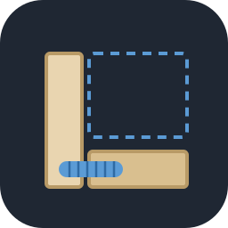
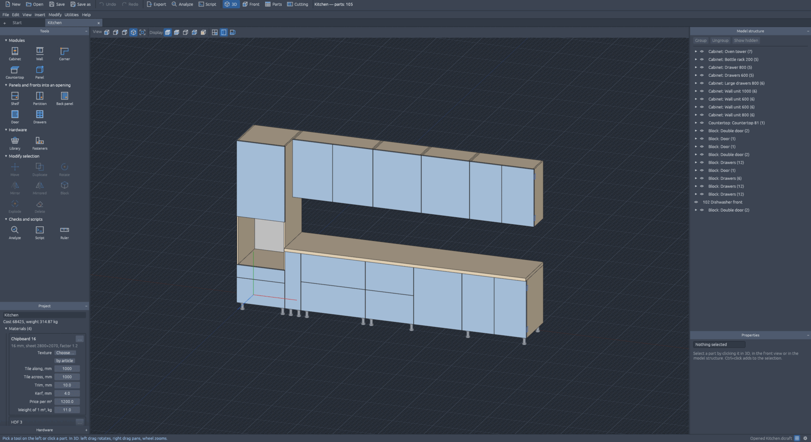
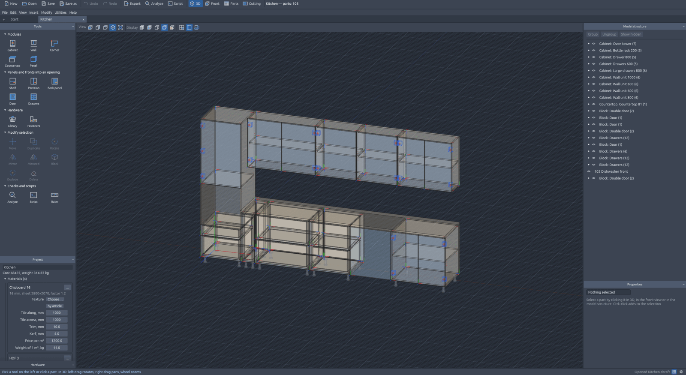
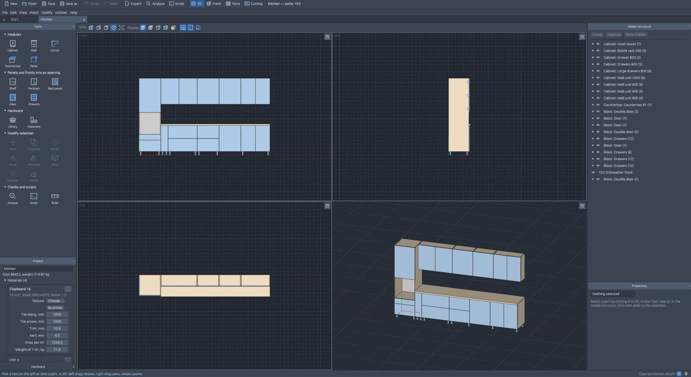
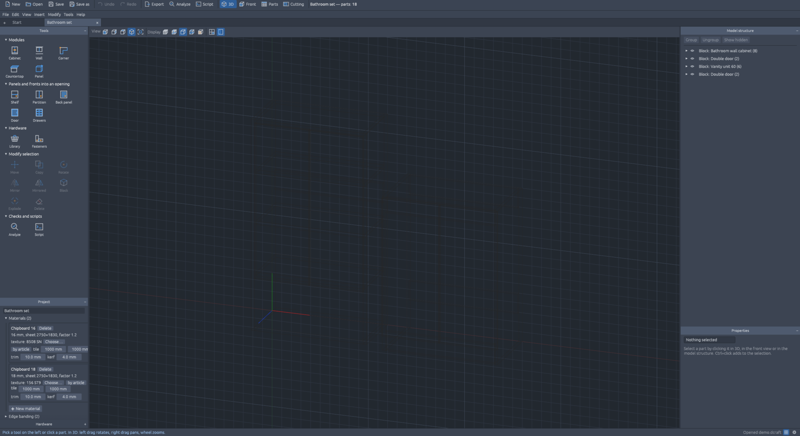
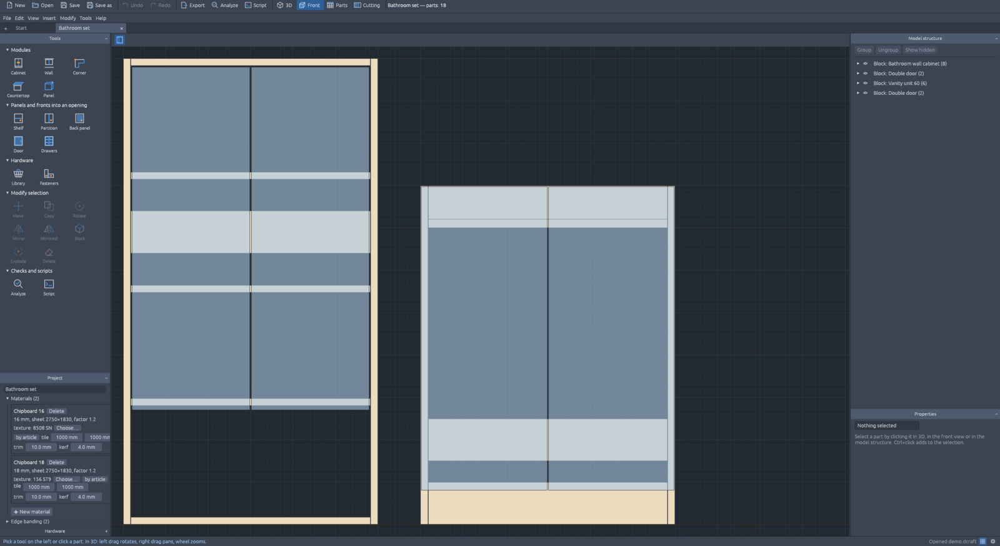
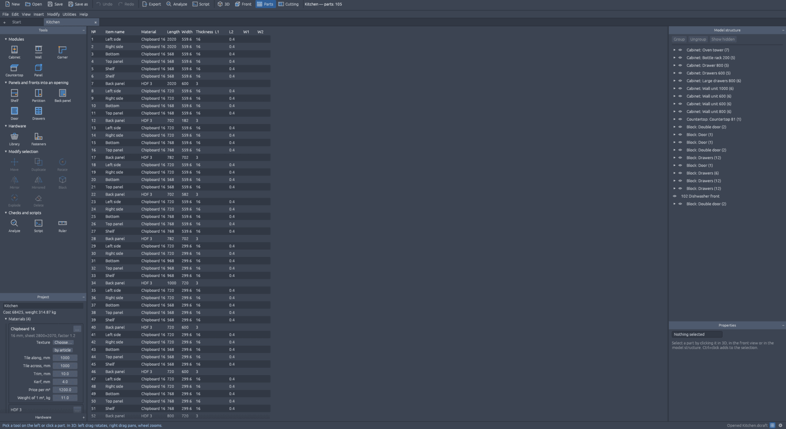
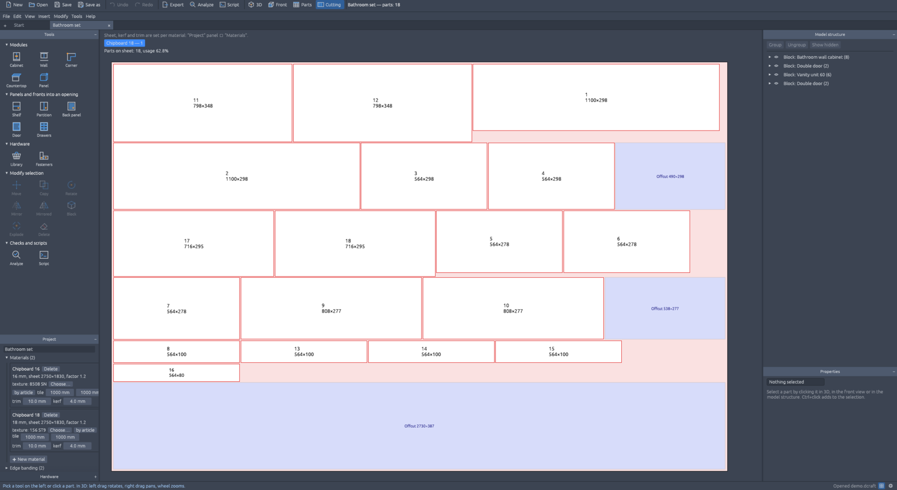

<p align="center"></p>

<h1 align="center">dowel-craft</h1>

<p align="center"><a href="../../README.md">English</a> · Русский</p>

<p align="center">
  <a href="https://github.com/shoman4eg/dowelcraft/actions/workflows/ci.yml"></a>
  <a href="https://github.com/shoman4eg/dowelcraft/releases"></a>
  <a href="../../LICENSE"></a>
</p>

> ⚠️ **Ранняя альфа.** Программа в активной разработке: возможны ошибки, формат проекта `.dcraft` может меняться. Перед отправкой в производство проверяйте размеры и присадку.

Программа для проектирования корпусной мебели: шкафов, кухонь, комодов, тумб, стеллажей. По модели она сама считает детали, раскрой листов, смету и чертежи. Модели Базис-Мебельщика (`.b3d`, `.fr3d`) открываются и выгружаются, проект для БАЗИС-Раскроя пишется в его формате.

Работает в Linux, macOS и Windows. Есть окно, командная строка и MCP-сервер, через который проектировать может ИИ-помощник (Claude и др.).

> dowel-craft — независимый проект, не связанный с компанией «Базис-Центр». Названия «Базис-Мебельщик» и «БАЗИС-Раскрой» упоминаются только для описания совместимости форматов.



## Содержание

- [Установка](#установка)
- [Возможности](#возможности)
- [Скриншоты](#скриншоты)
- [Окно программы](#окно-программы)
- [Горячие клавиши](#горячие-клавиши)
- [Командная строка](#командная-строка)
- [MCP — проектирование через ИИ](#mcp--проектирование-через-ии)
- [Файлы](#файлы)
- [Сборка из исходников](#сборка-из-исходников)
- [Устройство кода](#устройство-кода)
- [Выпуск версии](#выпуск-версии)

## Установка

**Homebrew** (macOS, Linux):

```sh
brew tap shoman4eg/tap
brew trust shoman4eg/tap
brew install dowel-craft
```

Поставится `dowel-craft`. Программы из Homebrew macOS не блокирует, снимать карантин не нужно.

На macOS команда `brew install --cask dowel-craft-app` ещё и кладёт **Dowel Craft** с иконкой в «Программы» и Launchpad. Приложение пока не заверено Apple; если macOS не даёт его открыть, выполните `xattr -dr com.apple.quarantine "/Applications/Dowel Craft.app"`.

**Или** готовые сборки — на странице [Releases](https://github.com/shoman4eg/dowelcraft/releases):

| Система | Установщик | Архив |
|---|---|---|
| Windows x86_64 | `dowel-craft-windows-x86_64.msi` | `dowel-craft-windows-x86_64.zip` |
| macOS Apple Silicon (M1 и новее) | `dowel-craft-macos-arm64.dmg` | `dowel-craft-macos-arm64.tar.gz` |
| macOS Intel | `dowel-craft-macos-x86_64.dmg` | `dowel-craft-macos-x86_64.tar.gz` |
| Linux x86_64 | — | `dowel-craft-linux-x86_64.tar.gz` |

- **Windows `.msi`:** ставит в Program Files, добавляет Dowel Craft в меню «Пуск», открывает проекты `.dcraft` двойным щелчком и добавляет `dowel-craft` в `PATH`.
- **macOS `.dmg`:** откройте и перетащите Dowel Craft в «Программы».

Архивы ставить не нужно: распакуйте и запустите `dowel-craft`. Это одна программа:
- `dowel-craft` или `dowel-craft проект.dcraft` — окно;
- `dowel-craft cut …`, `dowel-craft spec …` и другие команды — командная строка;
- `dowel-craft mcp` — MCP-сервер для ИИ.

На Windows в архиве есть ещё `dowel-craft.com`: в терминале `dowel-craft` запускает его, и вывод команд виден там.
В архиве для macOS есть ещё `Dowel Craft.app`.

- **macOS:** сборка не подписана, при первом запуске система её не пустит. Правая кнопка на приложении → «Открыть» или снимите карантин: `xattr -dr com.apple.quarantine "/Applications/Dowel Craft.app"` (для архива: `xattr -dr com.apple.quarantine dowel-craft-macos-*`).
- **Windows:** SmartScreen может предупредить о неизвестном издателе — «Подробнее» → «Выполнить в любом случае».
- **Linux:** нужны обычные библиотеки рабочего стола (Wayland или X11, Vulkan/OpenGL) — они есть в любой графической системе.

## Возможности

### Проектирование
- **Корпуса-шаблоны:** напольный корпус, навесной модуль, угловой Г-образный модуль, столешница. Меняете ширину — все детали пересчитываются.
- **У корпуса:** габариты, цоколь, задняя стенка (накладная или в паз: в боковинах, дне и крыше паз на 1 мм шире стенки, глубиной 8 мм, в 16 мм от заднего края; ширина, глубина и отступ меняются), перегородки, полки по секциям, двери, выдвижные ящики (высоты фасадов снизу вверх), материалы корпуса и фасадов, кромка.
- **Наполнение проёма мышью:** полка, перегородка, дверь, ящики — щелчок в проём на виде спереди, деталь встаёт между соседними. Отступы задаются. В занятый проём вторую дверь поставить нельзя.
- **Отдельные панели** в трёх плоскостях: двигать, вращать, копировать массивом, отражать, менять размер маркерами. Контур: скругления, фаски, вырезы, пазы вдоль торца.
- **Пазы** видны на чертежах деталей (с шириной × глубиной), в «Панелях в производство» и сохраняются при выгрузке в `.b3d`; в XML для Базис-Раскроя пока не выгружаются.
- **«Разрушить» шаблон** — корпус становится набором панелей, каждую можно править отдельно.
- **Группы (блоки):** собрать выделенное в группу, двигать и копировать целиком.
- **Формулы в полях:** `600-4`, `(W-T)/2` (W, H, D, P, T — ширина, высота, глубина, цоколь, толщина корпуса; можно русскими буквами Ш, В, Г, Ц, Т).
- **Отмена и возврат** любых изменений; недопустимое изменение (полка выше корпуса и т. п.) не применяется, причина видна внизу окна.
- **Несколько проектов** во вкладках, напоминание о несохранённых изменениях.

### Крепёж и фурнитура
- **Крепёж** с присадкой на обеих деталях каждого стыка: конфирматы, эксцентрики (Minifix), шканты, полкодержатели, «Minifix + шкант». У эксцентрика выбирается сторона чашки — внутри или снаружи корпуса.
- **Петли и направляющие** ставятся вместе с дверями и ящиками, со своей присадкой.
- **Модели фурнитуры Базиса** (`.fr3d`: корзины, петли, ручки, розетки) — библиотека по папкам с превью; их отверстия сами садятся в панели.
- **Схема присадки** — на чертежах деталей, с координатами отверстий.

### Просмотр
- **3D** с вращением, сдвигом и приближением; режимы: сплошной, невидимые линии тонко, каркас, прозрачность (рентген), в текстурах.
- **«4 окна»:** спереди, слева, сверху и 3D одновременно; любое окно разворачивается на всю область.
- **Вид спереди** для расстановки и перетаскивания деталей с прилипанием к соседним.
- **Текстуры материалов:** библиотека картинок с поиском, подбор декора Балтламината по артикулу, размер «плитки» текстуры на детали.
- **Структура модели:** дерево изделия, скрытие деталей и групп.
- **Сетка** в 3D и на виде спереди с настраиваемым шагом.

### Результат
- **Детали:** таблица с пильными размерами, материалом и кромкой.
- **Раскрой листов:** перебирает варианты укладки — сначала меньше листов, затем самый большой цельный обрезок. Свои формат листа, пропил и обрезка края у каждого материала.
- **Документы:**
  - карты раскроя и «Панели в производство» (HTML для печати, PDF);
  - проект для БАЗИС-Раскроя (XML, в том же виде, как его передаёт Мебельщик);
  - спецификация и смета (CSV для Excel): плиты в м², кромка в м, фурнитура в шт.;
  - сборочный и рабочие чертежи деталей (A4, HTML или PDF);
  - модель для Базис-Мебельщика (`.b3d`).
- **Анализ модели:** пересекающиеся детали, крепёж мимо панели, фурнитура без панели, детали больше листа.

### Совместимость с Базисом
- Открытие моделей `.b3d` и `.fr3d` для просмотра, раскроя и документов; «Сделать редактируемой» — превратить модель в свой проект.
- Выгрузка своего проекта в `.b3d`.
- Выполнение скриптов BAZIS-Script (`.js`), которые строят и меняют модель; окна скриптов показываются. Подробности — [docs/scripts.md](../scripts.md).

### Прочее
- Русский и английский: окно («Правка → Настройки → Язык»; по умолчанию английский), командная строка и MCP-сервер — `--lang ru` или `DOWEL_LANG=ru` (сообщения, имена деталей, карты раскроя, чертежи, CSV).
- Все горячие клавиши настраиваются.
- ИИ-помощник может править проект прямо в открытом окне (Linux и macOS).

## Скриншоты

| | |
|---|---|
|  **Прозрачность (рентген):** видны полки, крепёж и оси деталей |  **4 окна:** спереди, слева, сверху и 3D |
|  **Каркас** |  **Вид спереди:** расстановка полок, дверей и ящиков |
|  **Детали:** пильные размеры, материал, кромка |  **Раскрой листа** с деловыми обрезками |

## Окно программы

```
dowel-craft [проект.dcraft | модель.b3d]
```

- **Вверху** — строка кнопок (новый, открыть, сохранить, отменить, экспорт, анализ) и меню.
- **Слева** — «Инструменты» (что создать и как изменить), «Проект» (материалы и кромка), «Фурнитура» (библиотека моделей).
- **В центре** — «3D» (с кнопкой «4 окна»), «Вид спереди», «Детали», «Раскрой».
- **Справа** — «Структура модели» и «Свойства» выделенного.
- **Внизу** — подсказка, что делать дальше, и ошибки.

Первая мебель: «Проект» → «➕ Новый материал» → «Инструменты» → напольный корпус → его размеры в «Свойствах» → полки и двери щелчком в проём → «Раскрой» и «Файл → Экспорт». Подробная справка — [docs/help.md](../help.md) (она же в программе: «Справка»), по-английски — [docs/help.en.md](../help.en.md).

## Горячие клавиши

По умолчанию (меняются в «Правка → Настройки…»):

| Клавиши | Действие |
|---|---|
| 1, 2, 3, 4 | камера 3D: спереди, слева, сверху, аксонометрия |
| 5 | показать всё |
| Ctrl+1…4 | вкладка: 3D, вид спереди, детали, раскрой |
| Alt+1…5 | показ 3D: сплошной, невидимые тонкие, каркас, прозрачность, в текстурах |
| Ctrl+S | сохранить |
| Ctrl+Z / Ctrl+Y | отменить / вернуть |
| Del | удалить выделенное |
| F7 | сетка |
| Esc | выйти из инструмента или снять выделение |

Мышь в 3D: левая кнопка — вращать (или тянуть выделенную деталь), правая — двигать вид, колесо — приближать, Ctrl+щелчок — добавить к выделению.

## Командная строка

Модель — файл Базиса `.b3d` или свой проект `.dcraft`.

| Команда | Что делает |
|---|---|
| `dowel-craft spec <модель> [-o out.csv]` | спецификация деталей |
| `dowel-craft cut <модель> [-o карты.html] [--sheet 2800x2070] [--kerf 4] [--trim 10]` | раскрой: карты и «Панели в производство» |
| `dowel-craft smeta <модель> [-o smeta.csv] [--coef 1.2]` | расход плит и кромки, как смета Базиса |
| `dowel-craft raskroy <модель> [-o проект.xml] [--sheet 2800x2070]` | проект для БАЗИС-Раскроя |
| `dowel-craft drawings <модель> [-o чертежи.html\|.pdf]` | сборочный и рабочие чертежи |
| `dowel-craft check <модель>` | анализ модели |
| `dowel-craft dump <файл.b3d> [глубина]` | дерево модели Базиса (для отладки) |
| `dowel-craft import <файл.b3d> [-o проект.dcraft]` | модель Базиса → свой проект |
| `dowel-craft b3d <проект.dcraft> [-o модель.b3d]` | свой проект → модель Базиса |
| `dowel-craft script <проект.dcraft> <скрипт.js>` | выполнить скрипт Базиса над проектом |
| `dowel-craft design <проект.dcraft> <команда> ['{json}']` | команда проекта; файл создаётся, если его нет |

`--sheet` — формат листа в мм, `--kerf` — пропил, `--trim` — обрезка края, `--coef` — коэффициент расхода. Для проекта `.dcraft` они берутся из материалов, если не заданы.

Вывод по умолчанию на английском; `--lang ru` (или переменная `DOWEL_LANG=ru`) — сообщения, имена деталей и документы на русском.

Проект целиком из командной строки:

```sh
dowel-craft design шкаф.dcraft material.add '{"name":"ЛДСП Белый 16","thickness":16,"sheet":[2750,1830]}'
dowel-craft design шкаф.dcraft edge.add '{"name":"ПВХ 0,4","thickness":0.4,"width":19}'
dowel-craft design шкаф.dcraft cabinet.add '{"width":1200,"height":2200,"depth":600,"material":"ЛДСП Белый 16","edge":"ПВХ 0,4","plinth":80,"doors":2}'
dowel-craft design шкаф.dcraft shelf.add '{"cabinet":1,"height":700}'
dowel-craft cut шкаф.dcraft
```

`dowel-craft design --help` — все команды с параметрами (материалы, кромка, корпуса, ящики, угловые модули, столешницы, панели, блоки, крепёж, отмена).

## MCP — проектирование через ИИ

`dowel-craft mcp` запускает MCP-сервер (JSON-RPC через stdio). В Claude Code в папке этого репозитория он подключается сам файлом `.mcp.json`.

В другом месте, в Claude Code:

```sh
claude mcp add dowel-craft -- dowel-craft mcp
```

Другие MCP-клиенты — то же в настройках:

```json
{
  "mcpServers": {
    "dowel-craft": { "type": "stdio", "command": "dowel-craft", "args": ["mcp"] }
  }
}
```

После установки через Homebrew или установщиком Windows `dowel-craft` уже в `PATH`; если программа скачана архивом — укажите полный путь к файлу.

Обновляетесь с 0.3 и старше: отдельного `dowel-craft-mcp` больше нет. Подключите сервер заново: `claude mcp remove dowel-craft`, затем команда выше.

Инструменты:
- `project_new`, `project_open`, `project_import`, `project_save`;
- `command` — любая команда проекта (как `dowel-craft design`);
- `run_script` — скрипт BAZIS-Script над проектом;
- `parts`, `smeta`, `cut`, `export` (карты, XML Раскроя, CSV, чертежи, `.b3d`);
- `render_front`, `render_iso` — картинки вида спереди и 3D (PNG);
- `window_connect`, `window_disconnect` — работать с проектом, открытым в окне: изменения видны сразу, Ctrl+Z в окне их отменяет.

Пример запроса: «создай кухню: нижний модуль 600 с тремя ящиками, под мойку 800 с двумя дверями, навесные над ними и столешницу; покажи вид и раскрой».

## Файлы

| Расширение | Что это |
|---|---|
| `.dcraft` | свой проект (JSON): материалы, кромка, корпуса, панели, крепёж |
| `.b3d` | модель Базис-Мебельщика: открыть, выгрузить |
| `.fr3d` | фрагмент Базиса (фурнитура): библиотека, вставка в проект |
| `.js` | скрипт BAZIS-Script |
| `.xml` | проект для БАЗИС-Раскроя (выгрузка) |

Настройки окна (язык, клавиши, сетка, папки библиотек, недавние файлы) — в `~/.config/dowel-craft/` (Linux, macOS) или `%APPDATA%\dowel-craft\` (Windows).

## Сборка из исходников

Нужен Rust 1.95 или новее ([rustup.rs](https://rustup.rs)).

```sh
cargo build --release
```

Программа появится в `target/release/dowel-craft`.

В Linux для сборки окна понадобятся заголовки `libxkbcommon` и `libwayland` (Debian/Ubuntu: `sudo apt install libxkbcommon-dev libwayland-dev`).

Проверка:

```sh
cargo clippy --workspace --all-targets -- -D warnings
cargo test --workspace
```

Часть тестов сверяет результат с образцами Базиса из локальных папок `reference/` и `example/`. В репозитории их нет; без них такие тесты пропускаются.

## Устройство кода

- `crates/dowel` — вся логика:
  - `b3d.rs` — чтение и запись `.b3d`; `contour.rs` — контуры; `panel.rs` — детали и кромка;
  - `design/` — свой проект: корпуса, наполнение проёмов, команды, отмена, анализ;
  - `fasteners.rs` — крепёж и присадка;
  - `nest.rs` — раскрой; `report.rs` — карты и таблицы; `raskroy.rs` — XML для Раскроя;
  - `drawing.rs`, `pdf.rs` — чертежи и PDF; `export.rs` — выгрузка `.b3d`;
  - `job.rs` — «открыть → раскроить → документы» для CLI и окна;
  - `live.rs` — связь MCP с открытым окном;
  - `i18n.rs` и `lang/` — язык интерфейса: в коде английский, русский — в `lang/ru.tsv` (английский<TAB>русский), русские имена, нужные Базису (буквы формул, значения XML), — в `lang/bazis.tsv`. Тест падает, если кириллица попала в код.
- `crates/script` — выполнение скриптов BAZIS-Script (движок Boa).
- `apps/gui` — программа `dowel-craft`: окно (egui 0.36, 3D на wgpu); команды и `mcp` передаются в:
  - `apps/cli` — командная строка;
  - `apps/mcp` — MCP-сервер.
- `apps/console` — `dowel-craft.com` для терминала Windows.
- `docs/` — справка, формат XML БАЗИС-Раскроя (`formats/raskroy-xml.md`), скрипты.

## Выпуск версии

Сборки делает GitHub Actions:
- **CI** (`.github/workflows/ci.yml`) — на каждый пуш в `main` и PR: clippy и тесты в Linux, сборка в macOS и Windows.
- **Release** (`.github/workflows/release.yml`) — по тегу `v*`: сборка под Linux, macOS (Apple Silicon и Intel), Windows, архивы в GitHub Release рецепт и cask Homebrew в [shoman4eg/homebrew-tap](https://github.com/shoman4eg/homebrew-tap) (нужен секрет `HOMEBREW_TAP_TOKEN`).

```sh
git tag v0.4.0
git push origin v0.4.0
```

## Лицензия

MIT, см. [LICENSE](../../LICENSE). Сторонний код — в [NOTICE.md](../../NOTICE.md).
