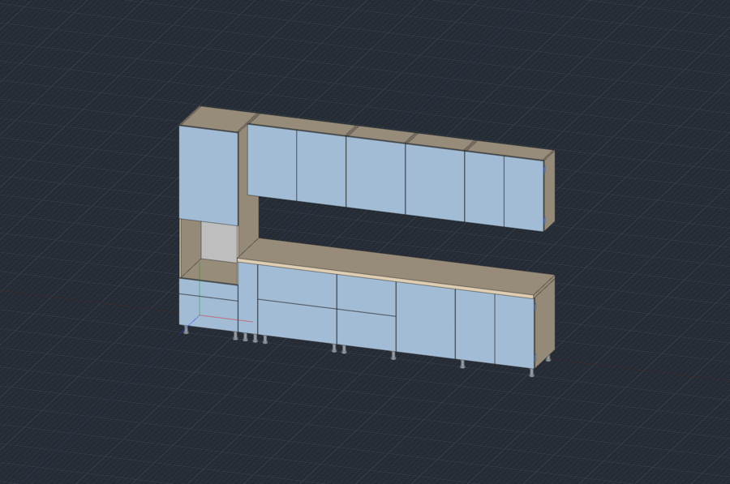

[Русский](README.ru.md)

# Example: a kitchen and everything it exports

`kitchen.dcraft` is a 3.6 m kitchen: an oven column, 4 base cabinets, a countertop and 4 wall cabinets, 105 parts in all. The [`exports/`](exports) folder holds every file dowel-craft makes from it, so you can see the results without installing anything.

| File | What it is | Where it goes | Command line | In the window: File → Export |
|---|---|---|---|---|
| [`cutting.html`](exports/cutting.html) | Cutting maps for every sheet and the “Panels for production” list | Print it from a browser for the saw operator | `dowel-craft cut kitchen.dcraft -o cutting.html` | Cutting maps and production list (HTML) |
| [`cutting.pdf`](exports/cutting.pdf) | The same cutting maps as a PDF | Send to the workshop, print without a browser | `dowel-craft cut kitchen.dcraft -o cutting.pdf` | Cutting maps (PDF) |
| [`bazis-raskroy.xml`](exports/bazis-raskroy.xml) | A BAZIS-Raskroy project: parts, edge banding and drilling holes with coordinates | Open in BAZIS-Raskroy; from there to the saw and the CNC | `dowel-craft raskroy kitchen.dcraft -o bazis-raskroy.xml` | BAZIS-Cutting project (XML) |
| [`parts.csv`](exports/parts.csv) | Parts list: cut sizes, material, edge banding on each side, grain | Excel, LibreOffice, a cutting optimiser or a production order | `dowel-craft spec kitchen.dcraft -o parts.csv` | Specification (CSV) |
| [`estimate.csv`](exports/estimate.csv) | Bill of materials: board in m², edge banding in m, hardware in pieces, with prices and weight | Excel or LibreOffice to price the order | `dowel-craft smeta kitchen.dcraft -o estimate.csv` | Material estimate (CSV) |
| [`drawings.html`](exports/drawings.html) | Assembly drawing and a drawing of every part with sizes and holes (A4) | Print from a browser for assembly | `dowel-craft drawings kitchen.dcraft -o drawings.html` | Drawings: assembly and parts (printable HTML) |
| [`drawings.pdf`](exports/drawings.pdf) | The same drawings as a PDF | Send to the workshop or the client | `dowel-craft drawings kitchen.dcraft -o drawings.pdf` | Drawings (PDF) |
| [`kitchen.obj`](exports/kitchen.obj) + [`kitchen.mtl`](exports/kitchen.mtl) | 3D model in millimetres with materials | Blender, 3ds Max, SketchUp and other 3D programs for a rendering | `dowel-craft obj kitchen.dcraft -o kitchen.obj` | 3D model (OBJ) for visualisation |
| [`kitchen.b3d`](exports/kitchen.b3d) | A Bazis-Mebelshchik model | Open and continue in Bazis-Mebelshchik | `dowel-craft b3d kitchen.dcraft -o kitchen.b3d` | Bazis-Mebelshchik model (.b3d) |

The CSV files use `;` and a decimal comma and open in Excel as they are. Add `--lang ru` to any command for Russian part names, documents and column headers.

[`make.sh`](make.sh) rebuilds the whole folder.
