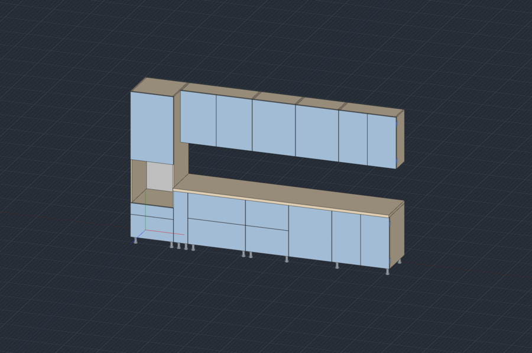

[English](README.md)

# Пример: кухня и всё, что из неё выгружается

`kitchen.dcraft` — кухня на 3,6 м: колонна под духовку, 4 нижних модуля, столешница и 4 навесных модуля, всего 105 деталей. В папке [`exports/`](exports) лежат все файлы, которые dowel-craft из неё делает, — результат можно посмотреть, ничего не устанавливая.

| Файл | Что это | Куда дальше | Командная строка | В окне: Файл → Экспорт |
|---|---|---|---|---|
| [`cutting.html`](exports/cutting.html) | Карты раскроя всех листов и список «Панели в производство» | Распечатать из браузера для пильщика | `dowel-craft cut kitchen.dcraft -o cutting.html` | Карты раскроя и «Панели в производство» (HTML) |
| [`cutting.pdf`](exports/cutting.pdf) | Те же карты раскроя в PDF | Отправить в цех, распечатать без браузера | `dowel-craft cut kitchen.dcraft -o cutting.pdf` | Карты раскроя (PDF) |
| [`bazis-raskroy.xml`](exports/bazis-raskroy.xml) | Проект БАЗИС-Раскроя: детали, кромка и присадка с координатами | Открыть в БАЗИС-Раскрое, оттуда — на пилу и ЧПУ | `dowel-craft raskroy kitchen.dcraft -o bazis-raskroy.xml` | Проект для БАЗИС-Раскроя (XML) |
| [`parts.csv`](exports/parts.csv) | Список деталей: пильные размеры, материал, кромка по сторонам, текстура | Excel, LibreOffice, программа раскроя или заказ на распил | `dowel-craft spec kitchen.dcraft -o parts.csv` | Спецификация (CSV) |
| [`estimate.csv`](exports/estimate.csv) | Смета: плита в м², кромка в метрах, фурнитура в штуках, с ценами и весом | Excel или LibreOffice — посчитать заказ | `dowel-craft smeta kitchen.dcraft -o estimate.csv` | Смета материалов (CSV) |
| [`drawings.html`](exports/drawings.html) | Сборочный чертёж и чертёж каждой детали с размерами и отверстиями (A4) | Распечатать из браузера для сборщика | `dowel-craft drawings kitchen.dcraft -o drawings.html` | Чертежи: сборочный и детали (HTML для печати) |
| [`drawings.pdf`](exports/drawings.pdf) | Те же чертежи в PDF | Отправить в цех или заказчику | `dowel-craft drawings kitchen.dcraft -o drawings.pdf` | Чертежи (PDF) |
| [`kitchen.obj`](exports/kitchen.obj) + [`kitchen.mtl`](exports/kitchen.mtl) | 3D-модель в миллиметрах с материалами | Blender, 3ds Max, SketchUp и другие 3D-программы — для красивой картинки | `dowel-craft obj kitchen.dcraft -o kitchen.obj` | 3D-модель (OBJ) для визуализации |
| [`kitchen.b3d`](exports/kitchen.b3d) | Модель Базис-Мебельщика | Открыть и дорабатывать в Базис-Мебельщике | `dowel-craft b3d kitchen.dcraft -o kitchen.b3d` | Модель Базис-Мебельщика (.b3d) |

CSV-файлы — с `;` и десятичной запятой, открываются в Excel как есть. С `--lang ru` у любой команды имена деталей, документы и заголовки столбцов будут на русском.

[`make.sh`](make.sh) пересобирает всю папку.
